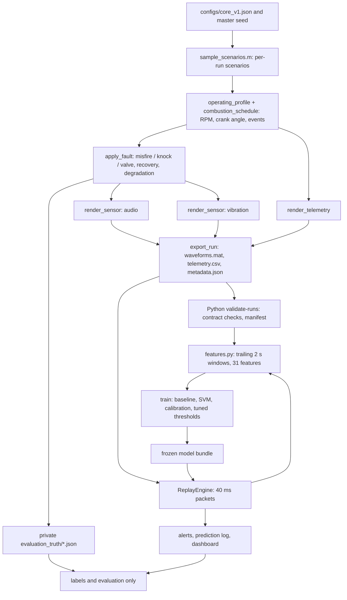

# Multisensor Engine Signature Extraction and Fault Recognition

## Final Project Report

| Document field | Value |
|---|---|
| Project context | Honeywell hackathon: automobile engine data, signature extraction, and pattern recognition |
| Report date | 15 October 2026 |
| Document version | 2.0 (final; supersedes the version 1.0 plan) |
| Project stage | Implemented prototype; frozen model scored once on held-out synthetic engines |
| Software | MATLAB R2026b (Signal Processing, Statistics and Machine Learning Toolboxes); Python 3.13 with NumPy, SciPy, pandas, scikit-learn, Streamlit, Plotly |
| Demo machine | macOS development machine, 8 CPU cores, 16 GB RAM |
| Detailed records | [docs/TESTING.md](docs/TESTING.md), [docs/DECISIONS.md](docs/DECISIONS.md), [docs/DATA_CONTRACT.md](docs/DATA_CONTRACT.md), [PROJECT_CHECKLIST.md](PROJECT_CHECKLIST.md) |

**Status statement.** Everything described as implemented below exists in this repository and was executed. All signals are synthetic, produced by our own MATLAB generator; organizers confirmed that team-generated synthetic data is allowed. Reported scores measure recognition of *simulated* patterns on held-out *virtual* engines. They do not establish diagnostic accuracy on a real engine, calibrated physical wear, or remaining useful life.

## Contents

1. Executive summary
2. Problem and objectives
3. What was built
4. System architecture and data flow
5. MATLAB synthetic-data generator
6. Dataset, labels, and reproducibility
7. Signal processing and signatures
8. Detection, classification, calibration, and alerts
9. Replay operation and dashboard
10. Verification
11. Results
12. Limitations and risks
13. Future work
14. Reproducing the results
15. Conclusion
16. References and glossary

## 1. Executive summary

We built a complete, reproducible engine-condition workflow that combines an acoustic channel, one vibration axis, and ECU-like telemetry:

- **MATLAB generator.** A configuration-driven event-and-response simulator of a four-cylinder, four-stroke engine. It renders synchronized audio (24 kHz), vibration (25.6 kHz), and six telemetry signals for normal operation and three modeled faults: intermittent misfire, knock-like bursts, and valve-clearance-like impacts. Fault onset, severity, intermittence, recovery, accelerated degradation, disturbances, and data-quality problems are all sampled reproducibly.
- **Python pipeline.** Validates every exported run against a written data contract, extracts 31 interpretable window features (2 s windows every 0.5 s), and trains a normal-baseline detector plus a calibrated RBF support vector machine.
- **Replay and dashboard.** Recorded runs are replayed in 40 ms packets through exactly the same feature code, model, and persistent-alert logic. A local Streamlit dashboard shows raw signals, spectra, a spectrogram, impulse envelope, telemetry with freshness, live predictions with calibrated confidence, evidence against a matched normal reference, and a simulated valve-wear trend.

**Headline results (4 held-out virtual engines, 32 core test runs, synthetic):**

| Measure | Result | Goal | Status |
|---|---|---|---|
| Window macro-F1 (4 classes) | 0.835 | ≥ 0.80 | Met |
| Per-fault window recall | knock 0.74, misfire 0.78, valve 0.71 | each ≥ 0.75 | Missed for knock and valve |
| False alerts during normal replay | 0 episodes in 7.8 normal minutes; 0 of 8 normal-only runs alerted | ≤ 0.2 per normal minute | Met (small denominator) |
| Sustained-fault detection | 17 of 28 events (61%) | — | Reported |
| Alert latency, sustained moderate/severe faults | p50 1.46 s, p95 2.48 s for detected events; 5 of 8 detected | p95 ≤ 4 s | Latency met; 3 of 8 missed |
| Processing per decision | p95 13 ms | p95 < 250 ms | Met |
| Degradation indicator vs true severity | median Spearman 0.906 (4 runs) | ≥ 0.7 | Met |
| Challenge runs (reserved conditions) | macro-F1 0.384; knock recall 0 | ≥ 0.65 | Missed |
| Telemetry-only shortcut control | macro-F1 0.199 (chance ≈ 0.25) | near chance | Met |

The system reliably separates healthy operation from strong faults and explains its alerts, but it misses mild faults and does not generalize to the reserved high-noise, extreme-RPM challenge conditions. Those failures are reported, not tuned away.

**Simultaneous faults (v2, §11.7).** A second MATLAB dataset, `core_v2`, puts 0, 1, 2, or all 3 faults in the same run, each with its own onset, cylinder, and severity. A v2 model with one calibrated detector and one alert per fault, plus new crank-synchronous vibration features, scored on four new held-out engines: window macro-F1 0.884 (the single-label v1 model scores 0.621 on the same windows and can never name two faults), every sustained fault alerted in 10 of 12 two-fault runs and 4 of 4 three-fault runs, and misfire/knock/valve sustained recall 0.96/1.00/0.94. Knock false alerts (0.30 per fault-free minute) exceeded the 0.2 goal, valve window recall is 0.62, and the mild challenge combinations are largely missed.

**Which cylinder (§11.8).** A cam phase reference (one pulse per 720°, data contract 1.1) lets every detected stroke be attributed to its cylinder by crank angle; a rotation-equivariant localizer then names the cylinder of each alert from per-cylinder vibration signatures. On the held-out core_v2 test engines it named the right cylinder in 71 of 71 true alert episodes, at the alert decision itself; in the mild multi-fault challenge runs the first answer was right in 16 of 22 episodes.

## 2. Problem and objectives

Engine signals change with speed, load, temperature, transmission path, and sensor placement, so a louder signal or a new spectral peak is not by itself a diagnosis. The problem statement asks for multiple sensor streams to be analyzed for recognizable signatures, normal baselines, fault recognition, and wear-related analysis, presented through a dashboard.

The question the prototype answers for each two-second window is:

> Does this window differ from normal operation at these operating conditions, which modeled condition best matches it, and what evidence should an engineer inspect?

Objectives, all implemented: generate consistent multisensor scenarios in MATLAB; validate and document them; align different-rate streams by timestamp; extract interpretable, operating-condition-aware signatures; detect abnormality separately from classification; classify modeled faults with a CPU-friendly model; display predictions with evidence; measure false alerts, misses, classification quality and latency; demonstrate a condition trend under accelerated simulated deterioration; and package the workflow for an offline demonstration.

## 3. What was built

| Area | Implemented | Not implemented / limited |
|---|---|---|
| Generator | Crank-angle event model; separate audio/vibration rendering; telemetry; 3 fault mechanisms; onset, severity, intermittence, recovery; accelerated valve degradation; unrelated impacts; combustion timing jitter; per-engine sensor variation; clipping, waveform gaps, telemetry dropouts; challenge settings | Clock offsets/drift; three-axis vibration; Simulink engine model |
| Data handoff | MAT v7 `single` waveforms, long-form CSV telemetry, JSON metadata, private truth JSON, SHA-256 manifest, MATLAB/Python round-trip summary | — |
| Features | 31 features: 14 per modality plus RPM/load/throttle context; causal trailing windows | Order tracking with a high-rate tachometer |
| Models | RPM×load-binned normal baseline; RBF SVM; sigmoid calibration on separate engines; tuned decision and alert rules | CNN comparison; combined faults |
| Runtime | 40 ms packet replay; quality states; persistent alerts; prediction logs; latency measurement | Live hardware acquisition |
| Dashboard | Banner, controls, presets, waveforms, envelope, PSD, spectrogram, telemetry freshness, timeline, truth overlay, evidence, wear indicator | Separate "unsupported operating region" state (folded into uncertain/quality) |
| Evaluation | Engine-level splits; tuning-only model selection; one-time test scoring; ablations; challenge set; failure examples | Confidence intervals by engine resampling |

## 4. System architecture and data flow



| Module | Location | Responsibility |
|---|---|---|
| Scenario sampling and simulation | `matlab/sim/` | Operating state, events, faults, sensor and telemetry rendering |
| Export and MATLAB checks | `matlab/export_run.m`, `validate_run_matlab.m`, `validate_generator.m` | Run bundles, per-run and generator validation |
| Data contract and import | `src/engine_diagnostics/data/run_io.py` | Loading, contract validation, warnings, manifest |
| Features | `src/engine_diagnostics/pipeline/features.py` | The single feature implementation for training and replay |
| Labels (evaluation only) | `pipeline/labels.py`, `evaluation.py` | Window labels and alert-episode scoring from truth |
| Models | `models/diagnostic.py` | v1 baseline, SVM, calibration, tuning |
| Runtime | `runtime/replay.py`, `runtime/alerts.py` | Packet replay, decisions, persistent alerts |
| Dashboard | `dashboard/app.py` | Local evidence display |

Truth files are written only to `evaluation_truth/` and are read only by labeling, evaluation, and the optional overlay. Tests check that the feature module imports no label or truth code and that a run loads without any truth present.

## 5. MATLAB synthetic-data generator

### 5.1 Engine and operating envelope

Four-cylinder, four-stroke engine, firing order 1-3-4-2, 800–3,500 rpm, normalized load 0.2–0.8, warm operation. A four-stroke engine fires `cylinders/2` times per revolution, so the firing frequency is `RPM/60 × 2` (60 Hz at 1,800 rpm).

### 5.2 Shared latent state

Crank angle is the integral of speed, `θ(t) = θ₀ + ∫ 6·RPM(u) du` in degrees. Combustion occurs 8° after each cylinder's firing TDC; each cylinder also has intake- and exhaust-valve closing impacts at fixed crank offsets. Events are keyed by crank angle and converted to time through the integrated RPM, so any RPM change, including the brief dip caused by a misfire, moves later events consistently in every stream.

Each event excites damped sinusoidal modes evaluated analytically at the exact sample times with a raised-cosine onset. Audio and vibration use different mode weights, path delays (2 ms vs 0.2 ms), resonance bands, gains, and noise, so they share causes without being scaled copies. Shaft-order tones (orders 2, 4, 6), colored noise, and white noise complete each channel.

### 5.3 Fault mechanisms (heuristic parameters)

| Condition | Intervention on the affected cylinder | Expected evidence |
|---|---|---|
| Misfire | With probability 0.15 + 0.6·severity, a combustion event drops to 3–15% intensity, with a brief RPM dip | Missing/weak pulses; irregular firing-peak envelope |
| Knock-like | With probability 0.3 + 0.5·severity, a damped 5–9 kHz burst (0.6–1.5 ms) 10–20° after combustion; burst frequency is engine-specific | High-band envelope kurtosis and variation |
| Valve-clearance-like | Valve impacts shift by up to 3°·severity, gain extra timing jitter, ring higher and shorter; amplitude may rise or fall | Changed impact timing/shape; subtle |

Physically motivated: crank-angle timing, firing order, shared events across sensors, structure-borne knock ringing. Heuristic: all amplitudes, frequencies, decay times, transfer settings, and fault mappings. None is fitted to engine measurements.

### 5.4 Lifecycle, disturbances, and data problems

Every scenario is drawn from distributions shared by all classes (`sample_scenarios.m`):

- Operating profile: steady, ramp, or 1 s load step; RPM 800–3,500; load 0.2–0.8.
- Faults: onset 6–22 s, severity 0.25–0.9, random cylinder; 35% get a 2–5 s recovery interval; half of valve runs are accelerated degradation (severity ramps 0.10 → 0.90).
- Disturbances in every class: unrelated broadband impacts (0.2–2 per s), combustion timing jitter, per-engine sensor gain and resonance variation.
- Data problems in every class: audio clipping (4%), waveform gaps of 0.1–0.4 s (6%), telemetry dropouts of 0.5–2 s (6%).
- Challenge runs (test engines only): RPM 3,000–3,500 or 800–900, 2× noise, +10% resonance shift, mild severity 0.15–0.3.

A random forest trained only on the observable scenario parameters (RPM/load level and change, profile kind, impact rate, data problems) reached 0.233 balanced accuracy across engine folds, at chance (0.25): operating context carries no class shortcut.

## 6. Dataset, labels, and reproducibility

### 6.1 Streams

| Stream | Rate | Unit | Use |
|---|---:|---|---|
| Audio | 24,000 Hz | normalized sensor units (not SPL) | Features |
| Vibration | 25,600 Hz | nominal m/s² (not calibrated) | Features |
| RPM | 50 Hz | rpm | Context and firing-period features |
| Load, throttle | 10 Hz | percent | Context |
| Coolant | 1 Hz | °C | Display |
| Short/long-term fuel trim | 2 Hz | percent | Display |

### 6.2 Dataset `core_v1`

| Partition | Engines | Runs | Clean windows* | Role |
|---|---:|---:|---:|---|
| Train | 18 | 144 | 7,124 (4,956 used after class balancing) | SVM and normal baseline |
| Tuning | 4 | 32 | 1,626 | Hyperparameters, thresholds, alert rules, feature choices |
| Calibration | 4 | 32 | 1,441 | Probability calibration |
| Test (core) | 4 | 32 | 1,568 | One-time final scoring |
| Challenge | same 4 test engines | 16 | 814 | Reserved conditions |

\*Clean windows exclude transition windows and windows with a non-ok quality state.

256 runs × 30 s (two per class per engine), 14,592 windows. Generation took 12.4 min with three parallel MATLAB processes; 0 runs were quarantined. Public data is 1.3 GB, truth 260 MB. The dataset is identified by `data/raw/core_v1/manifest.json` (SHA-256 `16a90def96a5…`). The original plan of 60 engines × 45 s was reduced by decision to fit the schedule; the split proportions were kept.

### 6.3 Labels

Each run's truth has a label timeline: normal, a 1 s `transition` around every fault start/end, the fault class, and normal again during recovery. A window is labeled only if it lies entirely inside one segment; otherwise it is a transition window and excluded from training and window scoring. Seeds, IDs, severity, fault schedule, and crank truth are never model inputs.

### 6.4 Reproducibility

Each run uses independent `mrg32k3a` substreams per purpose (profile, events, fault, audio, vibration, telemetry, disturbances) and per engine. Regeneration is bit-identical (`isequal` on arrays, CSV, and truth). Training is bit-reproducible. MATLAB records a waveform summary (counts, sums, first/last samples) that Python verifies after import.

## 7. Signal processing and signatures

Windows are trailing `[t−2, t)`; decisions every 0.5 s. Spectral filtering is done per window in the frequency domain, so there is no filter state to carry between packets, and offline features equal replay features exactly (verified: maximum difference 0 on all 481 integration windows).

| Family | Features (per modality) |
|---|---|
| Amplitude and distribution | log RMS, crest factor, kurtosis |
| Spectrum (Welch, 8,192-sample Hann, 50% overlap) | log band power; fractions in 6 bands (low edge–500, 500–1.5k, 1.5–3k, 3–5k, 5–7k, 7k–10 kHz) |
| Envelope | 5–10 kHz Hilbert envelope variation and kurtosis; 500–3,000 Hz envelope variation |
| Speed-normalized | Firing-peak variation: envelope peaks spaced by the firing period from observed RPM |
| Context | RPM, load, throttle (latest valid reading before t) |

Quality states: `missing_waveform` (>1% missing or short window), `clipped` (>0.5% at full scale), `stale_telemetry` (RPM older than 0.1 s, load/throttle older than 0.3 s). Windows with a non-ok state receive no prediction and hold the alert state.

MATLAB reference implementations of three features (log RMS, 5–7 kHz band fraction, high-band envelope kurtosis) agree with Python to 9.0×10⁻¹⁵ relative difference.

Two additional features (cycle periodicity of the impulse envelope and a 2–9 kHz spectral centroid) were tried to help valve clearance; they lowered tuning macro-F1 from 0.833 to 0.811 and were rejected before final scoring.

## 8. Detection, classification, calibration, and alerts

**Normal baseline.** Robust median/MAD statistics of the 28 waveform features from normal training windows, separately for 3 RPM bands × 2 load bands (each bin has 562–883 normal windows; a global fallback exists). The anomaly score is the RMS robust z-score against the window's own operating bin.

**Classifier.** RBF SVM on standardized features, balanced class weights, trained on 4,956 class-balanced training windows. Hyperparameters were chosen on tuning engines (C ∈ {1, 10, 30}, γ ∈ {scale, 0.03}); tuning macro-F1 was 0.829–0.833 across the grid, and C = 30, γ = 0.03 was selected.

**Calibration.** Sigmoid calibration of the frozen SVM on the four calibration engines; the dashboard shows the calibrated top-class probability.

**Decision rule.** A window is accepted as its top class if the calibrated probability is ≥ `p_min`; a "normal" result additionally requires the anomaly score to be below the threshold. Otherwise the decision is `uncertain`. Settings were swept on tuning runs to maximize sustained-event recall subject to ≤ 0.2 false-alert episodes per normal minute: `p_min` 0.7, anomaly threshold at the 95th percentile of training normal scores, no anomaly gate on faults.

**Alerts.** An alert is raised after 2 consecutive accepted decisions of the same fault and cleared after 3 accepted normal decisions; uncertain or bad-quality windows hold the state.

## 9. Replay operation and dashboard

Recorded runs are released at 1× in 40 ms packets. Each decision at time t is made once all samples before t have arrived, using samples sliced by absolute index (decision times fall mid-packet). Tests confirm that changing samples after t never changes the decision at t. Prediction logs record time, quality, class, probability, anomaly score, accepted decision, alert, processing time, and model/feature versions.

The dashboard (`uv run --all-extras streamlit run dashboard/app.py`, bound to localhost) provides:

- a permanent "SYNTHETIC DATA — RECORDED REPLAY" banner, model and feature versions;
- seven demo presets on held-out engines; play/pause, restart, speed, and seek (seek resets buffers and alerts and re-processes from the start);
- accepted decision, classifier class, calibrated confidence, anomaly score vs threshold, quality, processing and render time, alert status;
- last 2 s of audio and vibration, the 5–10 kHz impulse envelope, and the window PSD;
- a 10 s vibration spectrogram (STFT 2,048/512);
- RPM, load, throttle, coolant, and fuel trims with freshness status;
- a decision timeline with active alerts and an optional evaluation-truth overlay;
- the three largest robust deviations from the normal reference of the same operating bin;
- a simulated valve-wear indicator (5 s rolling mean of the calibrated valve probability), labeled as accelerated simulation, not remaining life.

Server-side render time is 112 ms median per 0.5 s tick (177 ms max); processing is 12–13 ms per decision.

## 10. Verification

| Layer | Evidence (details in [docs/TESTING.md](docs/TESTING.md)) |
|---|---|
| Generator | Firing frequency within 0.5% at 1,000/2,000/3,000 rpm; audio–vibration lag 1.75 ms vs 1.80 ms configured; noise-free energy above 0.9×Nyquist −53 dB (audio), −44 dB (vibration); bit-identical regeneration; severity sweeps increase for all faults |
| Per run | MATLAB validation 256/256 (lengths, dtype, firing count vs RPM within 2%, faulted events only after onset, intended signature); 10 low-severity knock runs flagged faint |
| Handoff | Python contract validation 256/256; 35 runs carry declared data-quality warnings |
| DSP | Analytical fixtures (sine RMS/crest/kurtosis, band placement), impulsive and missing-firing fixtures, MATLAB/Python agreement 9×10⁻¹⁵ |
| Integration | Replay equals offline features exactly; no future samples; alert persistence; reset |
| Leakage | Engine-level splits fixed before windowing; feature names exclude bookkeeping; inference modules import no label code; telemetry-only control at chance |
| Dashboard | Automated AppTest of all presets; localhost health check |
| Code | 68 pytest tests, Ruff clean; MATLAB Code Analyzer clean on all files |

## 11. Results

All results come from `reports/generated/final_evaluation_v1.json` (model SHA-256 `805e7559bc6a…`), produced once by `engine-diagnostics evaluate`. It was regenerated once with `--force` only to fix how a fully clipped degradation run was reported; all other values were programmatically confirmed identical. Per-class and moderate/severe breakdowns come from `reports/generated/final_evaluation_v1_breakdown.txt` (same frozen model, analysis only).

### 11.1 Core test windows (4 engines, 1,568 clean windows)

| | knock | misfire | normal | valve |
|---|---:|---:|---:|---:|
| Recall | 0.74 | 0.78 | 0.95 | 0.71 |
| Precision | 0.96 | 1.00 | 0.86 | 0.74 |

Macro-F1 0.835. Accepted (non-uncertain) decisions: macro-F1 0.859 at 78.8% coverage. Confusion matrix (rows truth, columns predicted, order knock/misfire/normal/valve): `[137,0,36,12] [5,161,35,6] [0,0,871,46] [1,0,73,185]`. Most errors are faults called normal; valve and normal are the most confused pair.

### 11.2 Core replay (actual packet replay of 32 runs)

- False alerts: 0 episodes in 7.76 normal minutes; none of the 8 normal-only runs alerted.
- Wrong-class alert episodes: 6.
- Sustained events detected: 17 of 28 (misfire 7/10, knock 7/9, valve 3/9). Latency p50 2.39 s, p95 14.8 s overall; slow-onset degradation runs (starting at severity 0.10) dominate the tail.
- Sustained moderate/severe events (severity ≥ 0.5, no ramp): 5 of 8 detected, latency p50 1.46 s, p95 2.48 s.
- Processing p95 13.0 ms per decision.
- Degradation indicator vs true simulated severity: Spearman 0.91, 0.90, 0.91, 0.78 (median 0.906). The fifth degradation run was fully clipped, so every window was correctly withheld as `clipped` and no trend exists.

### 11.3 Challenge runs (16 runs, reserved conditions)

Macro-F1 0.384; knock 0 of 6 sustained events detected (window recall 0), valve 1/4, misfire 3/4. False alerts 0.73 per normal minute (1 of 4 normal-only runs alerted). The model does not generalize to doubled noise, extreme RPM, and mild severity at the same time.

### 11.4 Modality ablations (same partitions and hyperparameters, core test windows)

| Inputs | Macro-F1 |
|---|---:|
| Telemetry only (RPM, load, throttle) | 0.199 |
| Audio + context | 0.823 |
| Vibration + context | 0.757 |
| Fused, without context | 0.832 |
| Fused (deployed inputs) | 0.837 |

Audio carries most of the discriminative information in this simulator; fusing vibration adds a little. Context alone is at chance, confirming that scenario sampling removed the shortcut found in the first integration batch (where telemetry alone reached 0.94 recall for two classes).

### 11.5 Failure examples

The most confident test errors are late windows of knock run `run_00222` (severity 0.66 at 1,229 rpm) predicted normal with 0.86–0.88 calibrated probability: knock bursts at low RPM are sparse in a 2 s window. Valve-clearance faults are often called normal because their signatures are subtle; the generator's own severity sweep showed only a 1.02–1.10× change in a simple envelope metric.

### 11.6 Acceptance record

| Area | Goal | Measured | Status |
|---|---|---|---|
| Generator reproducibility | Bit-identical regeneration | Identical arrays, telemetry, truth | Met |
| Split integrity | No engine across partitions | Engine-level splits; checks pass | Met |
| Core classification | Macro-F1 ≥ 0.80; each fault recall ≥ 0.75 | 0.835; knock 0.74, misfire 0.78, valve 0.71 | Partly met |
| Challenge classification | Macro-F1 ≥ 0.65 | 0.384 | Missed |
| Normal replay | ≤ 0.2 false alerts per normal minute | 0 (core), 0.73 (challenge) | Met on core |
| Processing | p95 < 250 ms | 13 ms | Met |
| Sustained moderate/severe alerting | p95 ≤ 4 s | 2.48 s for detected; 5/8 detected | Latency met, detection incomplete |
| Quality handling | Gaps/staleness/clipping produce visible states | `missing_waveform`, `stale_telemetry`, `clipped` shown and hold alerts | Met |
| Degradation indicator | Median Spearman ≥ 0.7 | 0.906 | Met |
| Demo stability | Three offline rehearsals | See docs/TESTING.md | Pending at time of writing |

### 11.7 Simultaneous faults: dataset `core_v2` and the v2 model

**Data (MATLAB, generator 0.3.0).** 30 new engines (`engine_031`–`engine_060`, own master seed), split 18 train / 4 tuning / 4 calibration / 4 test. Each engine has 2 normal runs, one run per single fault, one per pair, and one with all three: 270 core runs of 30 s, plus 16 mild multi-fault challenge runs on the test engines. Faults are applied in physical order (misfire → knock → valve), each with an independent onset, cylinder, severity, recovery, and degradation; a misfired stroke cannot also knock. All 286 runs passed MATLAB and Python validation. In the generator check, every fault keeps at least half of its single-fault signature effect inside every pair and the triple (weakest: valve in the triple, 52%).

**Model (v2.0.0).** One RBF SVM per fault (present vs absent), sigmoid-calibrated on the calibration engines, with its own threshold, uncertain band, and alert confirmation count chosen on tuning runs under the 0.2 false-alerts-per-minute goal. Each detector also chose its inputs on the tuning engines: misfire uses the base features plus new stroke-synchronous features, knock uses only the stroke-synchronous set, and valve uses vibration plus stroke-synchronous features. The new features (version 0.3.0) reference every 180° firing interval to the combustion onset and measure, per crank-angle sector and band, how much one of the four stroke groups (one cylinder) stands out. On the tuning engines they raised knock F1 from 0.57 to 0.97 and valve from 0.61 to 0.86. Test engines were scored once, after the model was frozen (model sha256 `ffbfa1be…`, manifest `825e2432…`).

**Core test windows (1,652 windows with every fault label known; 36 runs on 4 engines).**

| Fault | Precision | Recall | F1 | v1 recall (same windows) |
|---|---|---|---|---|
| Misfire | 1.00 | 1.00 | 1.00 | 0.89 |
| Knock-like | 0.95 | 0.87 | 0.91 | 0.45 |
| Valve-clearance-like | 0.94 | 0.62 | 0.75 | 0.18 |

| Faults truly active | Windows | Exact set correct | Every true fault detected | No false fault |
|---|---|---|---|---|
| 0 | 971 | 0.99 | — | 0.99 |
| 1 | 362 | 0.78 | 0.79 | 0.99 |
| 2 | 263 | 0.66 | 0.71 | 0.95 |
| 3 | 56 | 0.63 | 0.63 | 1.00 |

The frozen single-label v1 model, scored on the same windows, reaches macro-F1 0.621 and detects every true fault in 0% of two- and three-fault windows, because it can name only one class.

**Core replay (packet replay of all 36 test runs, one alert per fault).**

| Fault | Sustained events | Detected | Latency p50 / p95 | False alert episodes / fault-free minutes |
|---|---|---|---|---|
| Misfire | 25 | 96% | 1.4 / 2.6 s | 0 / 12.4 (0.00 per min) |
| Knock-like | 20 | 100% | 1.3 / 4.0 s | 4 / 13.2 (0.30 per min) |
| Valve-clearance-like | 16 | 94% | 7.5 / 13.9 s | 2 / 11.6 (0.17 per min) |

Every sustained fault was alerted in 12 of 12 one-fault runs, 10 of 12 two-fault runs, and 4 of 4 three-fault runs. The two incomplete two-fault runs: in `run_00258` the misfire alert did not start within its interval; in `run_00251` the valve alert fired 0.1 s before the valve fault began (triggered by knock on the same cylinder), so it counts as a false alert and the real valve fault as undetected. Two of eight normal runs raised a false knock alert. Processing is 23 ms p50 / 27 ms p95 per decision (the stroke-synchronous features add about 12 ms).

**Challenge (16 mild multi-fault runs: severity 0.15–0.3, reserved RPM bands, 2× noise).** Window macro-F1 0.444; misfire window recall 0.96 but knock 0.03 and valve 0.64 with many false positives; every sustained fault alerted in 1 of 12 two-fault runs and 0 of 4 three-fault runs. As with v1, mild faults under unseen conditions are not handled.

### 11.8 Cylinder localization (data contract 1.1)

**Why the old data could not name the cylinder.** One microphone and one accelerometer hear every cylinder through the same path, the crank phase at t = 0 is random per run, and RPM telemetry carries speed, not angle. A one-cylinder fault was visible as "one of the four firing slots" (the stroke-synchronous features already measured that), but which slot was cylinder 1 was unknowable.

**Reference.** The generator now emits a cam position pulse once per 720° at a configurable angle after cylinder 1's firing TDC (`engine.cam_sync_angle_deg`, 0), on the vibration clock, as an engine controller's cam sensor does. It uses no random numbers, so all 558 regenerated runs are otherwise bit-identical and the v1/v2 detectors and their reports remain valid. MATLAB checks that the pulses are phase-locked to cylinder-1 combustion (558/558).

**Attribution and signature.** Each stroke onset found by the stroke-synchronous features is placed in crank angle between the window's cam pulses (gaps several local cycles long count as missing pulses) and assigned the nearest firing-order TDC; on five runs every one of 8,337 strokes matched the truth cylinder. For each cylinder the signature is the log ratio of its mean stroke energy to the median cylinder in three bands (combustion 300–1000 Hz, mid 2–5 kHz, high 5–9 kHz) and six crank sectors. A misfire shows as a combustion-band deficit on its cylinder, knock as high-band excess just after its combustion, and a valve fault on cylinder c in the intervals of the cylinders that fire when its valves close (two and three positions later).

**Localizer (`localizer-1.0.0`).** One conditional-logit scorer per fault: each candidate cylinder's vector is the signature rotated so the candidate comes first (plus absolute values), scored with one standardized L2 logistic regression, softmaxed over the four candidates with a temperature fitted on the calibration engines. Equal weights for every rotation make it rotation-equivariant, so it also applies to relative slots. C was chosen on the tuning engines, then the minimum confidence for 95% accepted accuracy (0.4 for every fault). At runtime the per-window probabilities of each detected fault are averaged (EMA 0.35) and a cylinder is named after two windows; localization never raises, holds, or clears an alert. Without the reference (contract 1.0 data) slots are aligned across overlapping windows and reported as A–D, never as cylinder numbers.

| Held-out test engines (scored once) | Misfire | Knock-like | Valve-clearance-like |
|---|---:|---:|---:|
| Windows with the fault, top-1 cylinder | 360/360 | 323/323 | 527/547 (0.963) |
| Core replay: true alert episodes localized correctly | 24/24 | 23/23 | 24/24 |
| Challenge replay: first answer correct (final) | 8/10 (10/10) | 2/3 (2/3) | 6/9 (8/9) |

Every core episode was localized at the decision that raised the alert. Answers are judged only while the fault is active; a first scoring that also judged detector false alerts raised before onset gave challenge 0.58/0.60/0.50 (the report keeps both). Processing stays at 39 ms p95 per decision. The weak cases are interacting faults: a faint knock with a valve fault on another cylinder (whose impacts land in a third cylinder's firing interval) and mild valve faults under 2× noise.

### 11.9 Crankshaft speed, the ECU misfire monitor, and cylinder temperatures (data contract 1.2)

**Why.** Every production engine has a crank trigger wheel, and the ECU's own misfire monitor uses it: a cylinder that does not fire lets the crank slow through its expansion stroke. Aircraft piston engines also monitor exhaust gas temperature (EGT) and cylinder head temperature (CHT) on every cylinder. Both are physically independent of the microphone and accelerometer, so they can confirm an acoustic alert and name the cylinder a second way.

**Data (`core_v3`).** The generator adds two streams, each from its own random substreams. `core_v3` is `core_v2`'s 286 scenarios with the same seed: all 286 runs have audio, vibration, cam pulses and the six original telemetry signals bit-identical to `core_v2`, so the v2 detector and localizer apply unchanged.

- **60-2 wheel** (`render_crank_teeth.m`). This gives falling-edge times for 58 teeth per revolution. The crank speed combines:
  - the 1 kHz profile;
  - a stroke-resolved gas-torque ripple scaled by each stroke's combustion energy and load, and inversely with speed;
  - a misfire deficit that builds through the misfiring stroke and recovers;
  - a second-order inertia term.

  The tooth signal also has per-engine tooth-spacing errors and 1 µs timer jitter. The misfire recovery is sized so the wheel stays phase-locked to the acoustic events: the phase difference is 0.1° without misfire and about 2° p95 during dense misfire.
- **EGT and CHT per cylinder** (`render_thermal.m`). These follow a first-order lag (1.5 s and 8 s) toward a target set by each stroke's energy:
  - A misfiring cylinder runs cold: the EGT drop is 69–165 °C (minimum to median over 132 misfire runs).
  - Knock heats the head, not the exhaust. Severe detonation raises head heat flux while EGT stays flat or drops slightly.
  - A valve fault adds a small EGT rise (15 °C × severity, an assumption).

**Independent paths (no learned weights).** Thresholds are calibrated only on training-engine runs without the relevant fault.

- **Crank path.** It decodes the gap and cam phase, then measures 90° segment speeds centred on each firing TDC, where the inertia ripple cancels. The per-stroke metric is the kinetic-energy drop across each expansion stroke, detrended over 5 strokes. A cylinder whose mean roughness exceeds the others by a calibrated margin is alerted, with hysteresis. It names the cylinder from crank angle alone.
- **Simulated OBD-II monitor.** Per-stroke thresholds come from a speed table. Misfires are counted in 200-revolution blocks (type A, 5 % of strokes) and 1000-revolution blocks (type B, 1.5 %), and the monitor sets P030N or P0300. It has no knock or valve capability. Real catalyst-damage rates are often higher than 5 %, so this choice favours the ECU.
- **Thermal path.** Each cylinder is compared with the cross-cylinder median and with its own level in the first 5 s, and scaled by a healthy spread. The patterns are:
  - *cold* (EGT and CHT low) → misfire
  - *head hot, exhaust not* → knock
  - *exhaust hot, head not* → valve

**Results on the held-out test engines** (`evaluate-crosscheck`; v2 detector and localizer frozen; 36 core runs, 25 misfire intervals):

| Misfire intervals | Acoustic (v2) | Crank path | ECU type A | ECU type B |
|---|---:|---:|---:|---:|
| Detected before the run ended | 0.96 | 0.84 | 0.68 | 0.40 |
| Latency after onset, p50 | 1.4 s | 1.6 s | 5.9 s | 9.9 s |
| Cylinder correct when named | 1.00 | 1.00 | 1.00 | — |

- The acoustic alert came a median 4.5 s before the ECU's type A code (16 intervals where both fired). In 8 more intervals the ECU had set no code by the end of the run, although the acoustic alert had fired.
- The acoustic localizer and the crank path named the same cylinder in every interval where both named one.
- There were no crank alerts and no ECU codes in 10 minutes of runs without misfire.
- The ECU monitor covers none of the 20 knock and 16 valve intervals; the acoustic detector caught 20/20 and 15/16 of them.
- The thermal path detected misfire in 0.64 and knock in 0.65 of intervals, naming the right cylinder each time, with no false episodes on fault-free runs. It detected valve in only 0.06, because the assumed EGT rise is small against the normal cylinder spread.
- **Fused knock experiment** (acoustic knock AND thermal head-hot): false alerts per knock-free minute fell from 0.30 to 0.00, against 0.30 for the acoustic detector alone, which misses the 0.2 goal. The cost was sustained recall 1.00 → 0.80 and median latency 1.3 → 3.9 s.
- **Challenge runs (16).** These mild faults are hard for every path: misfire detected acoustic 0.47, crank 0.60, ECU type A 0.47.
- **Disclosure.** Hysteresis was added to the crank detector after the first test run; core results are unchanged.

The dashboard shows each of these:
- the crank speed per tooth and per stroke, the per-cylinder roughness, and the ECU monitor's blocks and codes beside the acoustic alert time ("5.1 s earlier");
- a thermal-camera-style view of the eight temperatures, with the trends;
- exhaust runners on the 3D engine colored by EGT;
- alert banners that say which independent paths agree.

## 12. Limitations and risks

- **Synthetic only.** The generator is not a validated digital twin; audio and vibration units are nominal. High scores here do not transfer to a real engine without real measurements.
- **Heuristic fault physics.** Fault mappings are designed to be plausible, not measured. The valve-clearance signature in particular is subtle, and the model detects it least well.
- **Mild faults and new conditions.** Low-severity knock (as low as 1.14× event-locked energy) and the challenge conditions are largely missed.
- **Simultaneous faults (v2).** Valve detection is the weak link (window recall 0.62), knock false alerts exceed the goal on the test engines (0.30 per fault-free minute, 4 episodes), and a fault on the same cylinder as another can trigger the wrong detector. Only one fault interaction (misfire suppresses knock) is modeled.
- **Small test set.** Four test engines and 7.8 normal minutes; the zero-false-alert result has a small denominator. Windows are correlated and are not independent trials.
- **Cylinder localization depends on the reference.** It assumes a healthy cam sensor at a known mounting angle and consistent sensor delays; cam faults are only unit-tested, and a wrong `cam_sync_angle_deg` shifts every answer by whole cylinders.
- **Crank and temperature physics are simplified.** With contract 1.2 data (`core_v3`, §11.9), the 60-2 wheel supports crankshaft-speed misfire diagnosis. The simulated crank omits torsional and flywheel resonances, driveline oscillation, and rough-road excitation, which make real misfire monitors harder; the ECU benchmark measures detection timing on this simplified crank. The EGT/CHT mappings, including the valve EGT rise and the shortened CHT time constant, are assumptions. 50 Hz RPM on older data still supports only context. Cylinder identification needs the cam phase reference (§11.8).
- **Not implemented:** clock offset/drift handling in replay, a separate unsupported-operation state, engine-resampled confidence intervals.
- **Wear.** The degradation indicator follows an accelerated simulated ramp; it is not a wear measurement or remaining-life estimate.

## 13. Future work

| Item | Benefit | Prerequisite |
|---|---|---|
| Real recordings | Measure the synthetic-to-real gap | Licensed data with operating and fault labels |
| Stronger valve and mild-fault signatures | Better recall on subtle faults | The crank wheel now gives exact crank angle (§11.9); retraining the stroke-synchronous and valve-timing features on it (core_v3) is the next experiment |
| Crank and thermal realism | Credible ECU benchmark | Torsional/flywheel dynamics, rough-road disturbance, and EGT/CHT data from a real engine |
| Robustness training | Challenge-condition generalization | Wider training distributions for noise and RPM |
| Clock drift and three-axis vibration | Realistic acquisition | Replay support for offsets; new rendering |
| CNN comparison | Learned representations | Frozen SVM baseline (available) |
| Physical severity / RUL | Maintenance forecasting | Calibrated damage and lifetime evidence |

## 14. Reproducing the results

```powershell
# Python environment
uv sync --locked --all-extras --group quality

# MATLAB (repository root): generate and validate the core dataset
#   addpath('matlab'); generate_dataset();          % ~40 min in one process
#   validate_generator();

# Python pipeline
uv run --all-extras engine-diagnostics validate-runs data/raw/core_v1
uv run --all-extras engine-diagnostics build-features --raw-dir data/raw/core_v1 `
    --truth-dir evaluation_truth/core_v1 --batch-config configs/core_v1.json `
    --output data/processed/core_v1_features.parquet
uv run --all-extras engine-diagnostics train
uv run --all-extras engine-diagnostics evaluate      # scores the test engines once
uv run --all-extras streamlit run dashboard/app.py
uv run --all-extras --group quality pytest

# Multi-fault dataset and v2 model
#   MATLAB: addpath('matlab'); generate_dataset(Config="configs/core_v2.json");   % ~38 min
scripts/run_pipeline_v2.sh            # validate, build features, train-multi, train-localizer
uv run --all-extras engine-diagnostics evaluate-multi          # scores the test engines once
uv run --all-extras engine-diagnostics evaluate-localization   # cylinder localization, once

# Crank wheel and cylinder temperatures (data contract 1.2)
#   MATLAB: addpath('matlab'); generate_dataset(Config="configs/core_v3.json");   % ~16 min, 4 workers
uv run --all-extras engine-diagnostics validate-runs data/raw/core_v3
uv run --all-extras engine-diagnostics calibrate-crosscheck     # training runs only
uv run --all-extras engine-diagnostics evaluate-crosscheck      # acoustic vs crank vs ECU, thermal
```

Generated data, models, and reports are excluded from Git and are reproduced by these commands; the manifest and model hashes above identify the exact versions reported.

## 15. Conclusion

The project delivers an end-to-end, reproducible workflow from a MATLAB multisensor engine simulator to a live, evidence-oriented replay dashboard, with honest engine-level evaluation. On held-out virtual engines it separates healthy operation from moderate and strong modeled faults with no false alerts during normal replay, explains each alert against an operating-matched normal reference, and tracks an accelerated simulated degradation trend. It does not yet detect mild faults reliably, its valve-clearance recognition is the weakest, and it does not generalize to the reserved challenge conditions. Every result above is synthetic; the next step is validation on real engine recordings.

## 16. References and glossary

### 16.1 References

These sources support engineering background and interface choices; they do not validate the generator.

1. [NASA Glenn: Bore and Stroke](https://www.grc.nasa.gov/www/k-12/airplane/stroke.html) — four-stroke cycle timing.
2. [Bosch Mobility: Knock Sensor](https://www.bosch-mobility.com/en/solutions/sensors/knock-sensor/) — structure-borne vibration sensing for knock.
3. [MathWorks: Detect Misfires Using On-Board Diagnostics](https://www.mathworks.com/help/autoblks/ug/use-obd-to-detect-misfire.html) — crankshaft-based misfire example.
4. [Jiang et al., Fault Diagnosis of Internal Combustion Engine Valve Clearance Using the Impact Commencement Detection Method, Sensors 17(12), 2916 (2017)](https://www.mdpi.com/1424-8220/17/12/2916).
5. [MathWorks: save](https://www.mathworks.com/help/matlab/ref/save.html) — MAT-file formats.
6. [SciPy: loadmat](https://docs.scipy.org/doc/scipy/reference/generated/scipy.io.loadmat.html) — MATLAB import.
7. [Scikit-learn: Common Pitfalls](https://scikit-learn.org/stable/common_pitfalls.html) — leakage prevention.
8. [Scikit-learn: Probability Calibration](https://scikit-learn.org/stable/modules/calibration.html).
9. [MathWorks: Predict Remaining Useful Life](https://www.mathworks.com/help/predmaint/predict-remaining-useful-life.html) — evidence needed for RUL.

### 16.2 Glossary

| Term | Meaning here |
|---|---|
| Accepted decision | A window class that passed the confidence and anomaly rules; otherwise "uncertain" |
| Alert episode | A continuous period with the same active alert |
| Challenge run | Test-engine run under reserved conditions not seen in training |
| Calibration | Mapping SVM scores to probabilities using separate engines |
| Envelope | Magnitude of the analytic signal of a band-limited window, showing impacts |
| Macro-F1 | Mean of per-class F1 scores |
| Operating bin | One of 3 RPM × 2 load ranges with its own normal reference |
| p95 | 95th percentile |
| Sustained event | A fault interval of at least 3 s |
| Synthetic replay | Recorded generated signals released at the playback clock |
| Transition window | A window spanning a fault start or end; excluded from scoring |
