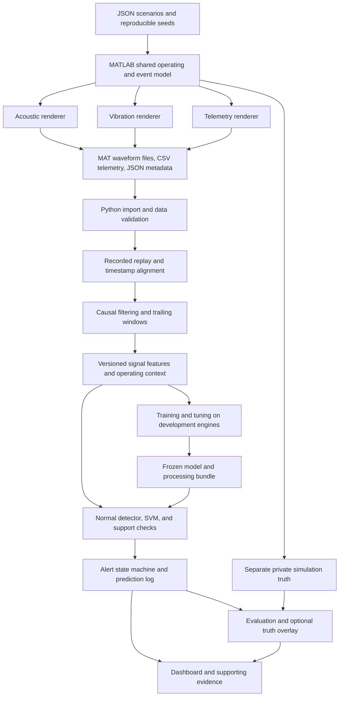

# Multisensor Engine Signature Extraction and Fault Recognition

## Project Report

| Document field | Value |
|---|---|
| Project context | Honeywell hackathon: automobile engine data, signature extraction, and pattern recognition |
| Report date | 15 October 2026 |
| Document version | 1.0 |
| Project stage | Initialization scaffold created; diagnostic capabilities remain planned |
| Assumed software access | MATLAB; individual toolboxes and Simulink to be checked separately |
| Recommended implementation | MATLAB data generation; Python analysis and ML; Streamlit dashboard |
| Execution checklist | [PROJECT_CHECKLIST.md](PROJECT_CHECKLIST.md) |

**Status statement:** The workspace now includes a Python package scaffold, shared JSON configuration and validation, data-contract documentation, and a MATLAB initialization function. This report describes the proposed diagnostic features; it does not claim that the generator, dataset, models, dashboard, or performance targets have been implemented or validated. All numerical performance thresholds are proposed acceptance goals until measured results are recorded.

## Contents

1. Abstract and executive overview
2. Problem statement and project objectives
3. Scope, users, and requirement coverage
4. Complete feature catalogue
5. System architecture and data flow
6. MATLAB simulation and synthetic-data generation
7. Dataset structure, labeling, and reproducibility
8. Signal processing and signature extraction
9. Fault detection, classification, and sensor fusion
10. Degradation monitoring and prediction boundaries
11. Dashboard features and user experience
12. Replay operation, alerts, and latency
13. Verification and evaluation methodology
14. Technology, resources, and implementation structure
15. Execution strategy and project management
16. Expected deliverables and demonstration
17. Risks, limitations, and future development
18. Acceptance and results record
19. Conclusion
20. References and glossary

## 1. Abstract and executive overview

This project proposes a reproducible engine-condition analysis prototype that combines acoustic signals, mechanical vibration, and numerical operating telemetry. The system will extract time-domain, frequency-domain, and speed-related signatures, establish normal operating references, and recognize selected simulated fault patterns.

The recommended prototype will distinguish normal operation from intermittent misfire, knock-like combustion bursts, and valve-clearance-like impact behavior. MATLAB will generate synchronized synthetic streams using a shared engine event schedule. Python will validate the exported data, extract features, train a support vector machine (SVM), and perform inference during recorded-data replay. A local dashboard will show raw signals, operating conditions, spectra, spectrograms, condition predictions, alerts, and supporting measurements.

The principal deliverable is the complete analytical workflow, including the data generator and its validation evidence. The project will also demonstrate an accelerated simulated degradation trend. It will not equate that trend with measured physical wear or predict remaining useful life without the necessary lifetime evidence.

**Features that define the project:**

- Synchronized synthetic audio, vibration, and ECU-like telemetry.
- Configurable MATLAB scenarios with reproducible fault onset, severity, and disturbances.
- FFT, power spectral density (PSD), STFT, envelope, and approximate order-based analysis.
- Operating-condition-aware normal-baseline detection.
- Four-class SVM classification using fused sensor features.
- Data-quality checks, uncertainty handling, and unsupported-operation states.
- Causal inference on two-second windows, updated every half-second during replay.
- An evidence dashboard with fault timelines and a simulated degradation indicator.
- Engine-separated evaluation, robustness tests, and versioned experiment artifacts.

## 2. Problem statement and project objectives

### 2.1 Problem context

Engine signals vary with speed, load, temperature, mechanical transmission paths, and sensor placement. Fault-related changes can overlap with ordinary operating changes. An increase in vibration or the appearance of a spectral peak is therefore insufficient, by itself, to establish a mechanical diagnosis.

The supplied problem statement asks for multiple sensor streams to be analyzed for recognizable signatures and presented through a dashboard. It also motivates normal baselines, fault recognition, and wear-related analysis. The team additionally requires an original synthetic-data generator rather than relying on an unspecified external dataset.

### 2.2 Primary objective

Develop a demonstrator that answers:

> Does the current signal window differ from the normal reference for these operating conditions, which modeled condition best matches it, and what evidence should an engineer inspect?

### 2.3 Specific objectives

1. Generate consistent multisensor engine scenarios in MATLAB.
2. Validate and document the generated data and assumptions.
3. Align different-rate streams using timestamps.
4. Extract interpretable signatures that account for RPM and load.
5. Detect abnormal operation independently of fault classification.
6. Classify selected modeled faults with a manageable CPU-based model.
7. Display predictions together with raw signals and supporting evidence.
8. Measure false alerts, missed events, classification quality, and latency.
9. Demonstrate a condition indicator during accelerated simulated deterioration.
10. Package the workflow for reproducibility and an offline hackathon demonstration.

## 3. Scope, users, and requirement coverage

### 3.1 Intended users and decisions

| User | Intended use | Decision supported |
|---|---|---|
| Maintenance/test engineer | Inspect operating state and abnormal signatures | Whether a pattern warrants further measurement or inspection |
| Signal-processing engineer | Compare sensor evidence and feature behavior | Whether an extracted signature is stable and informative |
| ML developer | Evaluate classification and failure cases | Whether model changes improve held-out performance |
| Hackathon evaluator | Follow a reproducible normal-to-fault demonstration | Whether the proposed workflow addresses the problem coherently |

The prototype will support investigation. It will not issue vehicle-control actions or authoritative repair instructions.

### 3.2 MVP scope

The MVP includes one acoustic channel, one vibration axis, operating telemetry, four operating-condition classes, synthetic-data validation, a normal detector, one SVM classifier, and a local replay dashboard. It includes a degradation indicator as a limited wear-related demonstration.

Genuine microphone/accelerometer acquisition, CAN decoding, electrical-current sensing, combined-fault classification, CNNs, and remaining useful life are outside the MVP.

### 3.3 Requirement traceability

| Supplied requirement | Planned project response | Coverage boundary |
|---|---|---|
| Multiple sensor streams | Audio, vibration, RPM/load/throttle/temperature/fuel trims | Synthetic streams |
| Engine audio signatures | Acoustic waveform, envelope, PSD, spectrogram | Approximated transfer paths |
| Mechanical vibration | Engine-event excitation and structural response | One simulated accelerometer axis |
| Numerical telemetry | Timestamped ECU-like operating fields | No actual OBD-II/CAN session |
| Normal baseline | Robust references conditioned on RPM/load | Supported simulator envelope only |
| Pattern recognition | Four-class feature-based SVM | Specified modeled conditions |
| Real-time faults | Causal inference during 1x recorded replay | Hardware acquisition deferred |
| Component wear | Accelerated simulated condition trend | No calibrated wear or RUL claim |
| Dashboard | Operating state, raw signals, signatures, prediction, timeline | Local application |
| Team-generated data | MATLAB generator, configuration, validation, data dictionary | Physical fidelity requires later evidence |

The named CNN, SVM, ANN, and softmax approaches are treated as examples rather than a requirement to implement every model family. Organizer confirmation should be recorded if this interpretation changes.

## 4. Complete feature catalogue

**Status key:** MVP = planned core feature; Conditional = used only when its supporting evidence or software is available; Future = outside the initial implementation. No entry below is a claim of completed implementation.

### 4.1 Simulation and data features

| ID | Feature | What it provides | Status |
|---|---|---|---|
| F01 | MATLAB scenario generator | Reusable, configuration-driven generation without physical engine access | MVP |
| F02 | Shared engine event model | Consistent RPM, crank progression, combustion, and valve events | MVP |
| F03 | Multisensor synthesis | Separate acoustic and vibration responses plus numerical telemetry | MVP |
| F04 | Four-condition scenario library | Normal, misfire, knock-like, and valve-clearance-like cases | MVP |
| F05 | Operating-profile variation | Steady RPM, ramps, load transitions, and normal variability | MVP |
| F06 | Fault lifecycle control | Configurable onset, intermittence, severity, recovery, and progression | MVP |
| F07 | Disturbance injection | Noise, placement/gain variation, drift, clipping, missing samples, and timing faults | MVP |
| F08 | Reproducible dataset packaging | Seeds, versions, checksums, run/engine IDs, schemas, and metadata | MVP |
| F09 | Generator validation | Structural, timing, bandwidth, consistency, and parameter-sensitivity checks | MVP |
| F10 | MATLAB-to-Python export | Numeric MAT files, telemetry CSV, and JSON metadata | MVP |

### 4.2 Analysis and recognition features

| ID | Feature | What it provides | Status |
|---|---|---|---|
| F11 | Timestamp-based multirate alignment | Consistent analysis intervals across different sampling rates | MVP |
| F12 | Causal preprocessing and quality gates | Filtering, DC removal, freshness checks, and invalid-data handling | MVP |
| F13 | Time-domain signature extraction | RMS, crest factor, kurtosis, and envelope/burst statistics | MVP |
| F14 | Frequency-domain analysis | FFT, Welch PSD, spectral ratios, and band energies | MVP |
| F15 | Time-frequency analysis | STFT spectrograms showing spectral evolution | MVP |
| F16 | Approximate RPM-normalized analysis | Broad order features and speed-context interpretation | MVP |
| F17 | Normal-baseline anomaly detection | Abnormality assessment conditioned on operating state | MVP |
| F18 | SVM fault classification | Best match among four modeled conditions | MVP |
| F19 | Sensor feature fusion | Joint acoustic, vibration, and observed operating-context input | MVP |
| F20 | Uncertainty and support checks | Uncertain, unsupported, and quality-insufficient decision states | MVP |
| F21 | Calibrated probability display | Probability estimates assessed on independent calibration engines | Conditional |
| F22 | Persistent alert state machine | Fault confirmation and clearing rules to reduce flickering alerts | MVP |
| F23 | Simulated degradation indicator | A causal condition trend during accelerated deterioration | MVP, limited wear demonstration |

### 4.3 Dashboard, evaluation, and delivery features

| ID | Feature | What it provides | Status |
|---|---|---|---|
| F24 | Controlled recorded replay | Scenario selection, play/pause, restart, seek, and warm-up status | MVP |
| F25 | Operating-state panel | RPM, load, throttle, coolant, fuel trims, and freshness | MVP |
| F26 | Interactive signal views | Waveforms, short-time zoom, PSD, spectrogram, and envelope | MVP |
| F27 | Prediction and evidence panel | Condition, score/status, alert, and matched-normal deviations | MVP |
| F28 | Fault timeline and truth overlay | Separate predictions, alerts, quality events, and private evaluation truth | MVP |
| F29 | Latency and prediction logging | Window times, model versions, inference timing, and alert history | MVP |
| F30 | Independent evaluation and ablations | Engine-level holdouts, modality comparisons, and robustness tests | MVP |
| F31 | Offline demonstration and fallback | Exported-data operation, rehearsed scenarios, recording, and static evidence | MVP |
| F32 | Documentation and traceability | Setup instructions, architecture, model/data cards, limitations, and reproducibility | MVP |
| F33 | Licensed Simulink comparison | Optional timing/dynamics reference for the MATLAB generator | Conditional |
| F34 | Expanded sensing and models | Three-axis vibration, real acquisition, CNN comparison, combined faults | Future |
| F35 | Physical wear/RUL estimation | Validated physical severity and service-life prediction | Future |

Sections 5-16 explain how these features will operate and how they will be assessed.

## 5. System architecture and data flow

### 5.1 Architecture



### 5.2 Module responsibilities

| Module | Responsibility | Main output |
|---|---|---|
| MATLAB operating model | RPM/load trajectory and crank/event timing | Shared latent operating state |
| MATLAB renderers | Separate sensor responses and telemetry sampling | Run bundle |
| Data importer/validator | Schema, dtype, timing, values, and quality | Accepted runs and validation reports |
| Replay adapter | Release available samples according to elapsed time | Timestamped packets |
| Analysis pipeline | Causal filters, windows, features | Fixed-order feature vectors |
| Training/evaluation | Development fitting and locked testing | Versioned model and metrics |
| Inference/alerts | Quality checks, classification, rejection, persistence | Prediction and alert records |
| Dashboard | Operating state and evidence presentation | Interactive local application |

Private truth must never enter model features or runtime decisions. The dashboard may display truth only through a separate evaluation overlay.

### 5.3 MATLAB-Python boundary

MATLAB is used offline for generation and reference analysis. Python imports saved outputs and owns the authoritative training/replay feature path. This avoids having to maintain equivalent production inference pipelines in both languages or keep MATLAB running during the presentation.

Numeric arrays will be exported in MAT Version 7, telemetry in CSV, and configuration/metadata in JSON. This is a design choice to simplify import: SciPy supports MAT formats through 7.2, while the 7.3 interface requires a different HDF5 path. [MATLAB save documentation](https://www.mathworks.com/help/matlab/ref/save.html), [SciPy loadmat documentation](https://docs.scipy.org/doc/scipy/reference/generated/scipy.io.loadmat.html).

## 6. MATLAB simulation and synthetic-data generation

### 6.1 Assumed engine and operating envelope

| Parameter | Proposed assumption |
|---|---|
| Engine family | Four-cylinder, four-stroke spark-ignition engine |
| Descriptive displacement | Approximately 1.6 L; not a calibrated physical model |
| Firing order | 1-3-4-2 |
| Valve schedule | Simplified two-valves-per-cylinder model |
| Speed | 800-3,500 RPM |
| Normalized load | 0.2-0.8 |
| Thermal scope | Warm operation; approximately 80-105 degrees C coolant |
| Exclusions | Detailed start, stall, fuel-cut, extreme overspeed, and thermodynamic transients |

A four-stroke cylinder completes its cycle in two crankshaft revolutions. Consequently, for the assumed evenly firing four-cylinder engine:

\[
f_{shaft}=RPM/60,\quad f_{cycle}=RPM/120,\quad f_{firing}=4RPM/120.
\]

At 1,800 RPM these are 30 Hz, 15 Hz, and 60 Hz. This is a timing calculation, not a diagnostic rule. [NASA four-stroke explanation](https://www.grc.nasa.gov/www/k-12/airplane/stroke.html).

### 6.2 Shared latent state

The generator will maintain operating speed, load, integrated crank angle, combustion events, valve events, thermal/control context, and fault state. Crank angle will evolve from the integral of speed:

\[
\theta(t)=\theta_0+2\pi\int_0^t RPM(u)/60\,du.
\]

Events will be triggered by crank position, preserving their recurrence during ramps. Each sensor will then apply its own response to the shared events:

\[
x_m(t)=\sum_j E_j h_{m,j}(t-t_j)+r_m(t)+n_m(t).
\]

Here, event energy and timing are shared; response kernels, rotational background, and noise depend on sensor and virtual engine. These are conceptual model equations. Their parameter mappings require simulator checks and later physical validation.

### 6.3 Normal operating model

Normal signals will contain combustion-energy variation, rotating components, ordinary valve impacts, structural resonances, colored background noise, and load-dependent excitation. Normal operation must be sufficiently variable to prevent the classifier from learning that any noise or impact means a fault.

Separate transfer responses will represent microphone location and structural accelerometer placement. The channels should share causes while differing in amplitude, filtering, and delay.

### 6.4 Fault scenarios

| Condition | Planned intervention | Observable evidence | Important limitation |
|---|---|---|---|
| Misfire | Weaken/suppress selected combustion events from one cylinder | Irregular envelope, weakened pulses, changed cycle-related modulation | Low-rate RPM is not a crankshaft diagnostic sensor |
| Knock-like fault | Add short damped bursts after selected combustion events | Impulsive high-band ringing in both sensor responses | High-frequency impacts have other possible causes |
| Valve-clearance-like fault | Modify recurring valve impact timing, shape, and variability | Changed envelope recurrence and response distribution | No calibrated clearance measurement |

Initial heuristic ranges include 40-95% energy reduction for affected misfire events, 5-9 kHz ringing with 1-5 ms decay for knock-like bursts, and approximately 2-12 crank degrees of valve-impact timing change. These are adjustable generator settings, not universal engine limits.

The mechanisms have an engineering basis: knock sensors respond to high-frequency structure-borne vibration, and a MathWorks misfire example uses crankshaft acceleration as an indicator. These facts motivate the simulator but do not validate its sensor waveforms. [Bosch knock sensor](https://www.bosch-mobility.com/en/solutions/sensors/knock-sensor/), [MathWorks misfire example](https://www.mathworks.com/help/autoblks/ug/use-obd-to-detect-misfire.html).

Experimental valve-clearance research identifies valve-closing impact timing as useful on its tested engine. The proposed MVP uses a simplified related mechanism and does not claim to reproduce that experimental diagnostic method. [Jiang et al., 2017](https://www.mdpi.com/1424-8220/17/12/2916).

### 6.5 Fault lifecycle and disturbances

Fault scenarios will include a normal lead-in, randomized onset, intermittent activity, severity ramps, and selected recovery. All classes will span overlapping RPM/load and sensor-gain distributions.

Disturbances will include colored noise, unrelated impacts, gain/placement changes, resonance variation, baseline drift, clipping, missing samples, telemetry jitter, and small clock offsets/drift. More difficult disturbances will be reserved for challenge evaluation.

The renderer will band-limit impulse content before downsampling. Normal and faulty cases will share resonance bands so that a single unique frequency cannot act as a fault label.

### 6.6 MATLAB and optional Simulink use

MATLAB functions will provide the default event-and-response generator. Installed products and runnable license availability will be recorded before relying on specialized functions. [MATLAB product inventory documentation](https://www.mathworks.com/help/matlab/ref/ver.html).

If an appropriate licensed Simulink example is available, a time-boxed comparison may improve timing/dynamics assumptions. The referenced MathWorks OBD misfire example lists Powertrain Blockset and AUTOSAR Blockset; MATLAB access alone does not establish access to that example's dependencies. [MathWorks example requirements](https://www.mathworks.com/help/autoblks/ug/use-obd-to-detect-misfire.html).

## 7. Dataset structure, labeling, and reproducibility

### 7.1 Stream specification

| Stream | Rate | Units | Role |
|---|---:|---|---|
| Acoustic waveform | 24 kHz | Normalized sensor units | Combustion/mechanical sound response |
| Vibration waveform | 25.6 kHz | Nominal simulated m/s^2 | Structural mechanical response |
| RPM | 50 Hz | rpm | Operating context and approximate order analysis |
| Load/throttle | 10 Hz | % | Operating condition |
| Coolant | 1 Hz | degrees C | Slow thermal context |
| Fuel trims | 2 Hz | % correction | Slow ECU-like context |

These rates describe generated streams, not guaranteed OBD polling rates. Acoustic units are not sound pressure level, and simulated acceleration requires later calibration. Slow RPM telemetry will be filtered before sampling rather than exposing hidden high-rate crank dynamics.

### 7.2 Planned dataset size

| Collection | Proposed size | Purpose |
|---|---|---|
| Integration | 12 runs x 20 seconds | Prove export, inference, and dashboard integration |
| Core | 60 engines x 8 runs x 45 seconds | Main independent development/test collection |
| Challenge | 32 additional 45-second runs | Unseen conditions and disturbances |
| Presentation | Separate selected runs | Rehearsal and demonstration |

The core has 480 runs and six hours of signals, with two runs per class per engine. The challenge extension brings the scored collection to 512 runs and 6.4 hours.

Float32 core waveform payload is approximately `480 x 45 x (24000 + 25600) x 4 = 4.285 GB`, before compression and metadata. Reserve 8-10 GB for the working collection, plots, features, and temporary artifacts. Generate and process runs incrementally.

### 7.3 Run bundle and labels

Each run will contain numeric waveform arrays, timestamped telemetry, public sensor/run metadata, and separately stored evaluation truth. Example planned layout:

```text
run_00421/
  waveforms.mat
  telemetry.csv
  metadata.json

evaluation_truth/
  run_00421_events.json
```

The waveform file will contain named arrays and sampling information. Telemetry rows will contain timestamp, signal name, value, unit, and validity. Metadata will identify schema, run, engine, sensor timing, and generator version. Private truth will describe the fault type, affected intervals/cylinder, actual events, and severity schedule.

Window labels will distinguish normal, observable fault, and transition/ambiguous cases. Initial clean-scoring rules require a fault to occupy at least 80% of a window and sufficient actual events to provide evidence. Sparse intermittent windows will not be silently relabeled normal.

### 7.4 Reproducibility and shortcut protection

Every run will retain its resolved configuration, independent random-stream references, versions, and checksums. A fixed environment will be used for reproducibility checks.

Model inputs will exclude filenames, run IDs, engine IDs, seeds, fault schedules, true severity, affected-cylinder metadata, and latent crank state. Gain and operating distributions will overlap across classes. Amplitude-matched probes and telemetry-only controls will test for shortcuts.

No external dataset is selected as a dependency. Any future dataset must pass access, license, sensor, operating-condition, and fault-label checks before use.

## 8. Signal processing and signature extraction

### 8.1 Alignment and preprocessing

All channels will be selected using the same trailing interval `[t-2, t)`. Waveforms retain their native sample rates; lower-rate telemetry contributes contextual features with freshness limits. Different-rate raw streams will not be forced onto one high-rate grid unnecessarily.

The pipeline will apply clock corrections, causal continuous filters, quality checks, windowing, and DC removal for spectral estimation. Filter state will be preserved between packets. The initial analysis bands are 20 Hz-10 kHz for acoustic and 5 Hz-10 kHz for vibration, with an additional high-band envelope branch.

Per-window unit-RMS normalization will be avoided because it could erase useful amplitude changes. The feature vector will contain both magnitude and ratio/shape features. Learned transforms will be fitted on training data only.

### 8.2 Analysis settings

| Setting | Acoustic | Vibration |
|---|---|---|
| Two-second window | 48,000 samples | 51,200 samples |
| Half-second step | 12,000 samples | 12,800 samples |
| Full-window FFT | Hann, 0.5 Hz bin spacing | Hann, 0.5 Hz bin spacing |
| Welch PSD | 8,192 samples, 50% overlap | 8,192 samples, 50% overlap |
| Welch bin spacing | About 2.93 Hz | 3.125 Hz |
| STFT | 2,048-sample Hann, 512-sample hop | 2,048-sample Hann, 512-sample hop |
| STFT bin spacing | About 11.72 Hz | 12.5 Hz |
| STFT time step | About 21.33 ms | 20 ms |

FFT spacing is not identical to true resolving ability; window shape and observation duration matter. The STFT will show spectral evolution, while raw zoom and envelope views will show millisecond bursts that the approximately 80-85 ms STFT window smears. [SciPy STFT documentation](https://docs.scipy.org/doc/scipy/reference/generated/scipy.signal.ShortTimeFFT.html).

### 8.3 Signature families

| Family | Proposed features | Intended interpretation |
|---|---|---|
| Time-domain amplitude | RMS, peak-to-peak, crest factor | Excitation magnitude and impulsiveness |
| Distribution | Kurtosis and selected quantiles | Burst-like or irregular behavior |
| Envelope | Variation, burst density, peak statistics, autocorrelation | Recurrent or missing event structure |
| Spectrum | Band energy, energy ratios, centroid, entropy | Distribution of energy across frequency |
| Speed-normalized | Broad order energies around 0.5, 1, 2, and 4 | Rotation/cycle-related structure |
| Cross-modal | Energy-envelope correlation and burst agreement | Shared events across sensors |
| Telemetry context | RPM mean/spread/slope, load, throttle/change | Operating-condition interpretation |

Start with approximately 40-60 features. Remove unstable/redundant features using development data. Coolant and fuel trims will initially support display rather than classification because their synthetic fault relationships are weakly constrained.

### 8.4 RPM normalization and interpretation

Approximate order features will use observed RPM to express recurrence relative to shaft speed. Structural resonances will also be retained in fixed-frequency bands. During rapid transients or stale RPM, order features may become unreliable, requiring a qualified or rejected result.

The prototype will not infer exact valve timing or identify a cylinder from low-rate RPM telemetry. A high-resolution tachometer and more precise angular processing are future improvements.

### 8.5 Mechanism-to-evidence chain

| Modeled condition | Signal change | Features | Dashboard evidence |
|---|---|---|---|
| Misfire | Missing/weakened combustion excitation | Envelope irregularity and cycle/order ratios | Weak-pulse regions and operating-matched reference |
| Knock-like | Short high-band bursts | Burst density, high-band ratios, kurtosis | Envelope peaks, raw zoom, PSD/spectrogram changes |
| Valve-clearance-like | Modified recurring impacts | Envelope recurrence, crest factor, band ratios | Repeating impact structure and condition trend |
| Normal RPM/load change | Recurrence/amplitude change consistent with operating state | Contextual features and normal residuals | Moving harmonics without persistent fault alert |

## 9. Fault detection, classification, and sensor fusion

### 9.1 Separate detection and classification

The normal detector will compare selected features against robust normal statistics in three RPM bands and two load bands. It will return an anomaly score or insufficient-reference state.

The SVM will classify valid supported windows into the four modeled classes. An abnormal window can therefore remain unresolved if its evidence does not confidently match a modeled fault.

### 9.2 Primary model and training

The initial model will be an RBF SVM with training-fitted scaling and approximately 6,000-8,000 representative training windows. Thinning overlapping windows controls kernel cost and prevents a few long correlated recordings from dominating the fit.

A small hyperparameter search will be performed using tuning engines. Acoustic, vibration, cross-modal, and observed operating features will be concatenated into one versioned feature vector. A CNN is deferred until a reliable baseline and evaluation procedure exist.

### 9.3 Uncertainty and operating support

The decision interface will support:

1. Normal within modeled coverage.
2. Suspected modeled fault.
3. Uncertain pattern.
4. Unsupported operating region.
5. Data quality insufficient.

Probability displays are conditional on independent calibration and reliability assessment. Otherwise, the dashboard will show a decision score without presenting it as percentage confidence. Calibration data must be separate from classifier fitting. [Scikit-learn calibration guidance](https://scikit-learn.org/stable/modules/calibration.html).

Support checks and rejection thresholds cannot guarantee detection of unknown faults. A new fault may still be confidently misclassified, which must be examined in challenge tests.

### 9.4 Model outputs and evidence

Prediction records will retain window boundaries, predicted class, score/probability type, quality/support status, alert state, feature/model versions, and processing timing. Supporting evidence will show deviations from normal reference distributions.

These measurements support interpretation; they are not a causal explanation of every SVM decision. Global feature contribution can be investigated with held-out permutation analysis if time permits.

## 10. Degradation monitoring and prediction boundaries

The project will demonstrate a condition indicator as a valve-like fault progresses under controlled or slowly changing operating conditions. The indicator will be computed from observed signal features and normalized against a development-data reference. Smoothing will be causal.

The hidden severity schedule may be revealed after inference for evaluation, but it will never be an input. The intended demonstration is a positive relationship between a measured signature and an imposed synthetic deterioration process.

| Task | MVP treatment | Evidence missing for stronger claims |
|---|---|---|
| Fault detection | Planned normal-deviation task | Real-engine baseline coverage |
| Fault classification | Planned four-class pattern recognition | Real labeled faults and domain validation |
| Severity estimation | Limited condition-indicator trend | Calibrated mapping to physical damage/clearance |
| Wear forecasting | Deferred | Longitudinal operating and degradation evidence |
| Remaining useful life | Deferred | Validated failure criterion and lifetime/degradation evidence |

The dashboard will label this feature “Condition indicator during accelerated simulated deterioration.” Replay seconds must not be interpreted as hours of useful service. RUL methods use historical/degradation evidence and yield uncertain estimates rather than deriving life from an arbitrary severity ramp. [MathWorks RUL guidance](https://www.mathworks.com/help/predmaint/predict-remaining-useful-life.html).

## 11. Dashboard features and user experience

### 11.1 Main panels

| Panel | Planned contents | User value |
|---|---|---|
| Provenance/status | Synthetic/replay banner, run/model version, playback status | Prevents confusion about acquisition mode |
| Operating state | RPM, load, throttle, coolant, fuel trims, freshness | Provides context for signal changes |
| Raw signals | Audio/vibration traces and zoom | Makes transient changes inspectable |
| Signatures | PSD, expected firing marker, spectrogram, envelope | Connects analysis to observed patterns |
| Prediction | Condition, quality/support state, score, alert | Communicates current interpretation |
| Evidence | Two or three matched-normal deviations | Explains why investigation is suggested |
| Timeline | Predictions, alert episodes, quality events | Reveals onset, persistence, and recovery |
| Degradation | Causal condition trend | Demonstrates limited progression monitoring |
| Evaluation view | Metrics, confusion matrix, optional truth overlay | Separates measured assessment from presentation |

### 11.2 User journey and controls

The user will choose a scenario, begin replay, inspect normal operation, observe an RPM/load change, and then see a modeled fault emerge. The dashboard will show the altered signatures before or alongside a persistent classification alert. The user can inspect waveform zooms and reveal simulation truth separately.

Controls will include scenario selection, play/pause, restart, and seek. Seeking will reset replay buffers, filter state, and alert history for the new position, with visible warm-up. Display traces may be decimated for responsiveness while analysis retains full-rate inputs.

Evidence language will be specific, such as “high-band energy ratio exceeds the normal reference for this operating region.” It will avoid assertions that a peak alone proves knock or that increased RMS proves wear.

## 12. Replay operation, alerts, and latency

### 12.1 Meaning of real-time in this prototype

The application will release recorded synthetic data at 1x elapsed time, using approximately 40 ms packets. It will analyze a trailing two-second window every 0.5 seconds. The first prediction is possible after the initial buffer fills.

No future samples, whole-run normalization, or future telemetry observations may influence a current result. Spectrogram slices must likewise be restricted to the available window rather than drawing future data from the stored run.

### 12.2 Alert state machine

The initial rule will confirm a fault after two consecutive accepted predictions of the same fault class and clear it after three accepted normal predictions. Quality failures interrupt confirmation and do not count as normal. The last valid result may remain visible only with its age and stale status.

Rules will be selected on tuning data and frozen before final evaluation. Persistence trades faster detection for fewer fluctuating alerts.

### 12.3 Quality and latency measurements

Initial quality limits will include more than 1% missing waveform samples, more than 0.5% clipping, RPM older than 100 ms, or load/throttle older than 300 ms. Isolated one- or two-sample repairs may be allowed and logged. These thresholds require validation and are not sensor standards.

Three measurements will be recorded separately:

- Processing latency: required samples available to inference completed.
- Display latency: inference completed to result visible.
- Detection latency: defined fault onset to confirmed alert.

The processing target is p95 below 250 ms on a declared machine. The four-second p95 detection goal applies only to predefined sustained moderate/severe faults; sparse intermittent events require separate reporting.

## 13. Verification and evaluation methodology

### 13.1 Independent partitions

| Partition | Engines | Core runs | Use |
|---|---:|---:|---|
| Training | 36 | 288 | Fit preprocessing, normal references, classifier |
| Tuning | 8 | 64 | Select model settings and decision thresholds |
| Calibration | 8 | 64 | Optional probability calibration |
| Final test | 8 | 64 | Locked performance assessment |
| Challenge | Final-test engine pool, new runs | 32 | Unseen operating and generation settings |

The same virtual engine and its response parameters will not cross partitions. Splits will be assigned before overlapping windows are created. All learned preprocessing will fit training data only. This follows established leakage-prevention guidance. [Scikit-learn common pitfalls](https://scikit-learn.org/stable/common_pitfalls.html).

One 45-second run produces 87 two-second windows with a half-second step; the core has at most 41,760 windows before exclusions. These windows are correlated and must not be reported as that many independent experiments.

### 13.2 Verification layers

| Layer | Planned checks |
|---|---|
| Generator | Timing, bandwidth, onset behavior, seed repeatability, intended interventions |
| Data handoff | MATLAB/Python shape, precision, timestamps, orientation, field units |
| DSP | Known tone/RMS fixtures, PSD scaling, envelope behavior, order response |
| Integration | Offline/replay feature agreement, state resets, no future-data access |
| ML | Group integrity, preprocessing isolation, ablations, shortcut probes |
| Runtime | Quality states, alert maturation/clearing, processing/display latency |
| Delivery | Offline setup, complete rehearsal, fallback usability |

### 13.3 Metrics and challenge conditions

Report macro-F1, balanced accuracy, per-class precision/recall/support, and confusion matrices. For detection, report false alert episodes per normal minute, event recall, missed events, and median/p95 latency. Report rejected-data coverage and unresolved known-class samples so that selective predictions cannot hide failures.

Challenge tests will include held-out seeds and engines, reserved RPM regions, changed resonance/damping, changed gains, lower SNR, healthy operating ramps, unrelated impacts, mild/intermittent faults, timing corruption, missing data, and selected unfamiliar/combined patterns.

Compare telemetry-only, acoustic-plus-context, vibration-plus-context, and fused inputs using the same partitions. Additional modalities are beneficial only if measured results demonstrate an improvement.

Uncertainty intervals should resample engines or runs rather than individual overlapping windows. Calibration plots and probability-quality metrics are required if confidence percentages are displayed.

### 13.4 Evaluation boundaries

A generator can create internally consistent but unrealistic distinctions. Testing unseen seeds and parameters helps expose simulator-specific shortcuts but does not substitute for independent real measurements. Final-test results must remain separate from tuning; a redesign informed by those results requires fresh evaluation data.

## 14. Technology, resources, and implementation structure

### 14.1 Technology allocation

| Technology | Planned responsibility | Dependency condition |
|---|---|---|
| MATLAB | Scenario generation, export, reference plots | Access assumed |
| Signal Processing Toolbox | Optional convenient MATLAB reference analysis | Product/license availability to verify |
| Simulink and engine-related products | Optional timing/dynamics comparison | Not assumed from MATLAB access |
| NumPy/SciPy | Import, filtering, FFT/STFT, feature extraction | Pinned compatible Python environment |
| pandas/PyArrow | Telemetry/features/manifests | Local storage |
| scikit-learn | Preprocessing, SVM, calibration, metrics | CPU execution |
| Streamlit/Plotly | Local dashboard and interactive evidence | Browser on demo machine |
| pytest | Meaningful data, DSP, and integration checks | Development environment |
| JSON/CSV/MAT/Parquet | Portable configuration and data exchange | Versioned schemas |

No GPU, cloud service, API credentials, database, or physical engine is required for the proposed MVP. A practical planning allowance is an ordinary development laptop with approximately 8-16 GB RAM and 8-10 GB free working storage, subject to measurement. This is not a certified minimum specification. No pricing is assumed beyond the MATLAB access supplied by the user.

### 14.2 Proposed source structure

The following is an intended organization, not a list of existing implementation files:

```text
matlab/              scenario generation, renderers, export, reference analysis
configs/             engine, sensor, scenario, split, and threshold definitions
schemas/             run, telemetry, feature, and prediction contracts
data/                manifests and generated runs; avoid committing bulk data by default
evaluation_truth/    private source events and labels
src/data/            import and validation
src/pipeline/        alignment, filtering, windows, features
src/models/          training, calibration, evaluation
src/runtime/         replay, inference, alerts, logs
dashboard/           Streamlit application
tests/               data, DSP, leakage, and integration checks
reports/             generator validation and evaluation outputs
docs/                setup, data/model cards, assumptions, limitations, demo script
```

A model bundle will include its fitted preprocessing, classifier, feature order, baseline references, optional calibration, thresholds, and version identifiers. Incompatible feature schemas must cause an explicit failure rather than a silent prediction.

## 15. Execution strategy and project management

### 15.1 Milestones and outputs

| Milestone | Completion condition | Main owner |
|---|---|---|
| Scope/contracts | Roles, rates, units, formats, and class definitions agreed | Technical lead |
| Early vertical path | Small MATLAB batch reaches actual replay inference/dashboard | MATLAB and integration leads |
| Generator validation | Reproducible mechanisms pass timing/bandwidth/shortcut checks | MATLAB and DSP leads |
| Dataset freeze | Engine-separated manifests, validated runs, locked test set | Data/ML lead |
| Analytical bundle | Shared features, baseline, SVM, thresholds frozen | DSP/ML leads |
| Integrated MVP | Evidence panels, alerts, quality states, and logging work together | Dashboard lead |
| Evaluation | Metrics and limitations trace to exact versions | Evaluation lead |
| Submission | Rehearsed offline demo, documentation, fallback, required package | Technical lead |

Use [PROJECT_CHECKLIST.md](PROJECT_CHECKLIST.md) for the detailed task sequence and exit checks. Roles are responsibilities rather than an assumed team size.

### 15.2 Critical path and parallel work

The critical path is contracts, MATLAB export round trip, early replay, generator validation, frozen dataset/features/model, final integration/evaluation, and rehearsal.

The dashboard shell can proceed after contracts; analytical DSP checks can precede bulk generation; documentation follows decisions continuously. Avoid independently implementing incompatible feature pipelines in MATLAB and Python.

Reach a small working path within the first 20% of elapsed time. Reserve the final 20% for verification, documentation, and demonstration stability. After that feature freeze, accept correctness, reproducibility, and necessary performance fixes only.

If time is limited, remove optional Simulink work and future features, reduce dataset size while preserving independent groups, and simplify dashboard redraws. A further explicit scope reduction may remove one fault class. Data validation, causal processing, honest evaluation, and rehearsal remain essential.

## 16. Expected deliverables and demonstration

### 16.1 Deliverables

| Deliverable | Expected contents |
|---|---|
| MATLAB generator | Configurable operating/fault scenarios, sensor renderers, exports |
| Dataset package | Sample runs, schema, dictionary, seeds/configurations, regeneration instructions |
| Validation report | Timing, bandwidth, consistency, reproducibility, and sensitivity evidence |
| Analysis pipeline | Shared features and MATLAB/Python reference comparisons |
| Model bundle | Baseline, SVM, preprocessing, thresholds, schema, optional calibration |
| Dashboard | Replay, telemetry, waveforms, signatures, predictions, evidence, timeline |
| Evaluation report | Metrics, ablations, challenge results, latency, rejection, failures |
| Documentation | Setup, architecture, model/data cards, limitations, source references |
| Submission materials | Presentation, screenshots, demo script, fallback recording |

### 16.2 Main demonstration

Use a separate approximately 45-second scenario. Begin with normal operation, introduce a moderate RPM/load change, establish a new plateau, then activate a moderate knock-like fault. Show signature changes, the persistent alert, its timing, and the measurements supporting it. Reveal the truth overlay only after the inference path has been demonstrated.

Use a short second scenario to show an accelerated valve-like condition trend. Explain that it is not a service-life estimate.

The fallback will include a verified local model/data bundle, a complete screen recording, and static figures. Cached predictions or a recording must be labeled as such. The final demo should run three times offline on the presentation machine.

## 17. Risks, limitations, and future development

### 17.1 Priority risks

| Risk | Consequence | Planned mitigation |
|---|---|---|
| Generator shortcuts | High scores without meaningful pattern learning | Overlapping parameter distributions, amplitude matching, ablations |
| Synthetic-to-real gap | Unsupported engine claims | Explicit simulator boundaries and later real-data validation |
| Operating-condition confounding | Healthy ramps trigger faults | Contextual references, broad order features, normal-transient tests |
| Overlapping-window leakage | Inflated evaluation | Engine-level split before windowing |
| Timing/future-data errors | Incorrect signatures and latency | Causal processing, correction tests, replay equivalence |
| Confusable impacts | Wrong fault class | Multiple measurements and uncertain state |
| Toolbox dependency | Blocked MATLAB approach | Verify products early; retain event-based MATLAB/Python path |
| Scope/runtime pressure | Incomplete demonstration | Early vertical path, bounded model size, freeze and fallback |

### 17.2 Limitations

The generator is not a validated digital twin of a specific engine. Its acoustic and acceleration values are not calibrated measurements. The classifier covers a small set of modeled conditions, and rejection cannot ensure unknown-fault safety. Low-rate RPM supports operating context rather than precise crankshaft diagnosis. The dashboard displays evidence, not certified mechanical root cause.

### 17.3 Future development

| Feature | Benefit | Prerequisite |
|---|---|---|
| Three-axis vibration | Directional/placement robustness | New rendering and evaluation |
| High-resolution order tracking | Better angular/transient interpretation | Suitable measured tachometer/speed information |
| Verified real recordings | Assess generator assumptions and domain shift | Access, license, usable operating/fault metadata |
| Genuine acquisition | Hardware demonstration | Sensors, interfaces, synchronization, permissions |
| CNN comparison | Learned-representation experiment | Reliable baseline and frozen independent evaluation |
| Combined-fault recognition | Broader operating cases | Multi-label data and new evaluation design |
| Physical severity/RUL | Maintenance forecasting | Calibrated damage and longitudinal lifetime evidence |

## 18. Acceptance and results record

### 18.1 Proposed acceptance targets

| Area | Proposed goal | Current evidence |
|---|---|---|
| Generator reproducibility | Repeat seed/configuration reproduces validated arrays | Not yet measured |
| Split integrity | No engine/run leakage across independent partitions | Not yet implemented |
| Core classification | Macro-F1 at least 0.80; each fault recall at least 0.75 | Not yet measured |
| Challenge classification | Macro-F1 at least 0.65 with rejection/coverage disclosed | Not yet measured |
| Normal replay | At most 0.2 false alert episodes per normal minute | Not yet measured |
| Processing | p95 below 250 ms per inference update | Not yet measured |
| Sustained-fault alerting | p95 within four seconds for predefined moderate/severe cases | Not yet measured |
| Quality handling | Injected severe gaps/staleness produce visible quality states | Not yet measured |
| Degradation indicator | Proposed median held-out progression Spearman correlation at least 0.7 | Not yet measured |
| Demo stability | Three consecutive complete offline rehearsals | Not yet performed |

### 18.2 Required final evidence

Before submission, replace unmeasured entries with actual values or explicit unmet status. Retain dataset version, model version, code revision, machine specification, evaluation duration, engine/run counts, exclusions, rejected coverage, confusion matrix, latency distribution, and representative failure cases.

Do not invent screenshots, benchmark tables, accuracy values, hardware demonstrations, or measured wear results. If a goal is missed, report the measured outcome and explain its implications.

## 19. Conclusion

The proposed project combines a reproducible MATLAB data generator with a Python diagnostic pipeline and an evidence-focused dashboard. Its planned features cover multisensor synthesis, operating variation, controlled fault lifecycles, interpretable signal signatures, normal detection, SVM recognition, quality/uncertainty handling, replay alerts, and independent evaluation.

A successful MVP will demonstrate a complete and inspectable workflow on specified synthetic conditions. Its strongest defensible claim will concern reproducibility and measured recognition within the documented simulation tests. Real-engine diagnosis, calibrated wear, and remaining useful life require additional evidence beyond this prototype.

## 20. References and glossary

### 20.1 References

The supplied official problem statement and [PROJECT_CHECKLIST.md](PROJECT_CHECKLIST.md) define project scope. The following primary sources support engineering background and interface choices; they do not independently validate the proposed generator.

1. [NASA Glenn: Bore and Stroke](https://www.grc.nasa.gov/www/k-12/airplane/stroke.html) — four-stroke cycle timing.
2. [Bosch Mobility: Knock Sensor](https://www.bosch-mobility.com/en/solutions/sensors/knock-sensor/) — structure-borne vibration sensing for knock.
3. [MathWorks: Detect Misfires Using On-Board Diagnostics](https://www.mathworks.com/help/autoblks/ug/use-obd-to-detect-misfire.html) — crankshaft-based example and listed product requirements.
4. [Jiang et al.: Fault Diagnosis of Internal Combustion Engine Valve Clearance Using the Impact Commencement Detection Method](https://www.mdpi.com/1424-8220/17/12/2916) — experimental valve-impact timing study, Sensors 17(12), 2916 (2017).
5. [MathWorks: save](https://www.mathworks.com/help/matlab/ref/save.html) — MAT-file formats.
6. [SciPy: loadmat](https://docs.scipy.org/doc/scipy/reference/generated/scipy.io.loadmat.html) — supported MATLAB import formats.
7. [MathWorks: ver](https://www.mathworks.com/help/matlab/ref/ver.html) — installed product/version inventory.
8. [SciPy: ShortTimeFFT](https://docs.scipy.org/doc/scipy/reference/generated/scipy.signal.ShortTimeFFT.html) — STFT settings and frequency/time axes.
9. [Scikit-learn: Common Pitfalls](https://scikit-learn.org/stable/common_pitfalls.html) — preprocessing isolation and leakage prevention.
10. [Scikit-learn: Probability Calibration](https://scikit-learn.org/stable/modules/calibration.html) — calibration and independent fitting evidence.
11. [MathWorks: Predict Remaining Useful Life](https://www.mathworks.com/help/predmaint/predict-remaining-useful-life.html) — evidence and model context for RUL.

### 20.2 Glossary

| Term | Meaning in this project |
|---|---|
| Baseline | Reference distribution for normal signals under supported operating conditions |
| ECU-like telemetry | Simulated numerical fields resembling engine operating measurements |
| FFT | Fourier transform computation used to inspect frequency components |
| STFT | Repeated windowed transforms showing frequency content over time |
| PSD | Power distribution per unit frequency |
| Envelope | A representation of amplitude variation used to study impacts and recurrence |
| Order | Frequency expressed as a multiple of shaft rotational frequency |
| SVM | Support vector machine used for the planned fault classifier |
| Sensor fusion | Combining features from different sensor modalities and operating context |
| Leakage | Evaluation information improperly influencing training or model selection |
| Calibration | Checking/fitting how prediction scores correspond to observed probabilities |
| p95 | The 95th percentile of a measured latency distribution |
| RUL | Remaining useful life before a defined repair/replacement/failure criterion |
| Synthetic replay | Recorded generated signals released according to a playback clock |
